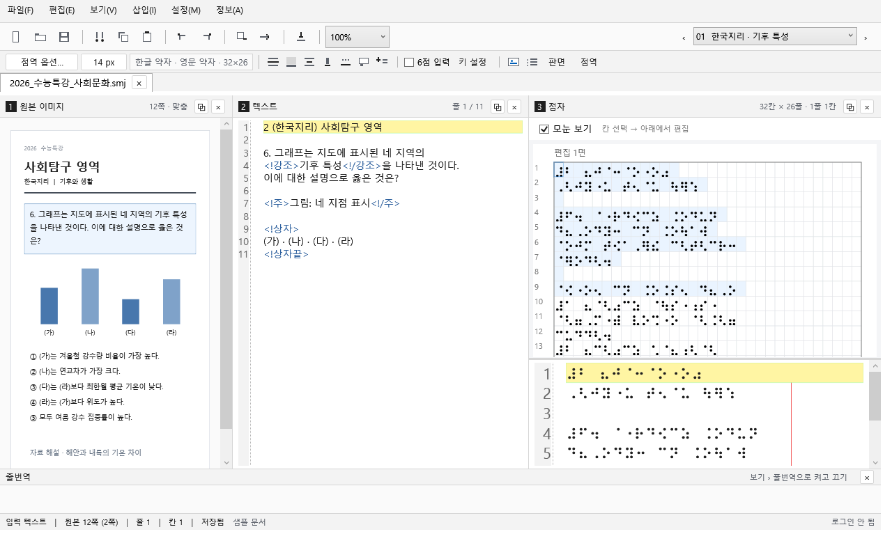
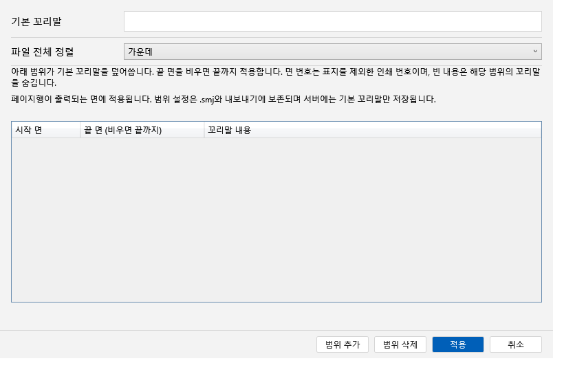
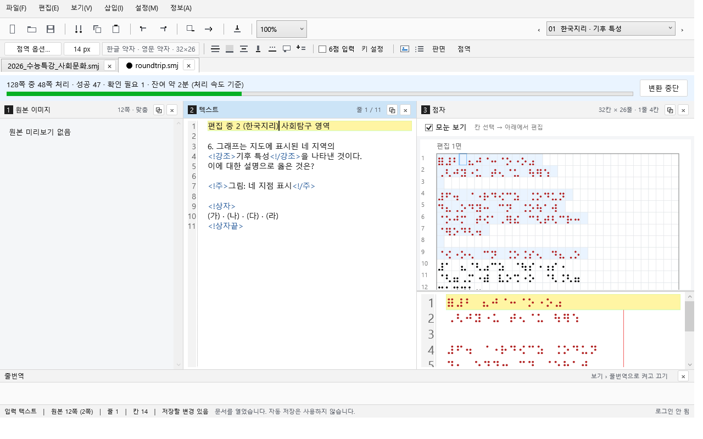

# Windows 검증 기록

2026-10-19. 아래는 실제 실행 결과이며, 운영 서버 E2E 또는 전체 기획 완료를 뜻하지 않는다.

## 통과한 실행

- 커밋 `e7b0cf293127fd82423be5bc338635d5e3657d25`: [Windows editor 39260156835](https://github.com/Semojum/Semojum/actions/runs/39260156835), 전체 성공.
- macOS Windows 교차 빌드: 경고 0, 오류 0. Python v3.4.24 포함 핵심 검사 55/55.
- Windows 핵심 검사 54/54(실제 엔진을 지정하지 않은 단계), Python·패키징 엔진을 지정한 통합 검사 56/56.
- WPF 56개 검사, PDF 내용·1800px 비율·잘못된 PDF 이후 복구, 정상 종료 코드 0.
- 실행 환경: GitHub windows-latest의 Windows Server 2025, .NET 10.0.13. Windows 10/11 사용자 PC의 IME·보조기기·다중 DPI·프린터 검증은 별도다.

머리말 검사는 실제 엔진으로 현재 면 적용, 이전 면 보존, 같은 면의 해제, 블록 내부 위치, 매칭 불가능한 수동 점자 보호를 확인한다. 실행 취소 검사는 블록 병합/구간 대체와 메모 보존, 재점역 뒤 원문 이력 유지, 분리 창에서 점자와 수동 수정 상태 복원을 포함한다.

## 종료 오류 재현과 수정

[이전 실행 e9edb73](https://github.com/Semojum/Semojum/actions/runs/39259153846)은 UI 검사 뒤 종료 코드 `0xC000000D`로 실패했다. CI 전용 네이티브 진단으로 `Windows.Data.Pdf.dll → d3d11.dll → d3d10warp.dll → ntdll.dll` 호출을 수집했다. 프로세스 종료 시 Windows PDF 구성 요소가 그래픽 자원을 해제하는 경로에서 발생했다.

PDF 미리보기를 PDFtoImage 5.4.0 / PDFium의 CPU 렌더링으로 교체했다. 렌더링을 직렬화하고 네이티브 비트맵·PNG 스트림은 작업 안에서 해제하며, WPF에는 독립된 동결 비트맵만 전달한다. PDF 검사를 제거하거나 비정상 종료를 성공으로 처리하지 않았다. 위 통과 실행에서 같은 PDF 내용 검사와 정상 종료를 함께 확인했다. 임시 네이티브 진단 코드는 검증 후 제거한다.

PDFium 152.0.7961의 배포 라이선스는 공식 `chromium/7961` 릴리스에서 가져왔고, 해당 DLL의 SHA-256과 NuGet의 win-x64 DLL이 일치함을 확인했다. 라이선스와 서드파티 고지는 `licenses/`에 보존한다.

## 실제 화면

아래 이미지는 위 통과 커밋에서 WPF를 실행해 캡처한 화면이다. 검사별 전체 화면과 `checks.txt`는 실행의 `wpf-smoke` 아티팩트에 있다. 실행 가능한 포터블 ZIP은 `Semojum-win-x64` 아티팩트에 있다.

운영 로그인·유료 변환·서버 저장 성공·실제 배포 업데이트·물리 인쇄는 실행하지 않았다. 신규 점자 저장 ID 결함은 [BE 수정 제안](backend-save-review.md), 미지원 엔진 옵션과 모눈 좌표 한계는 [엔진 계약](engine-contract.md), 후속 범위는 [구현 상태](implementation-status.md)를 따른다.
