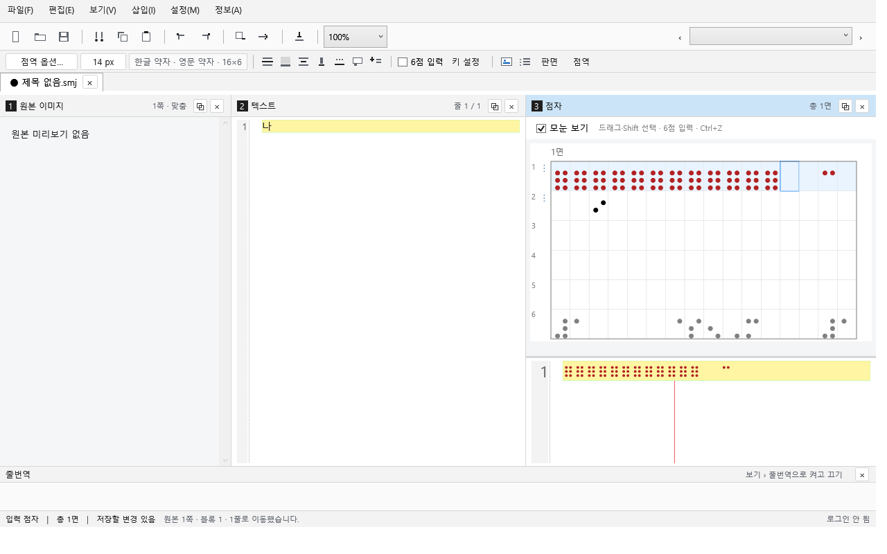
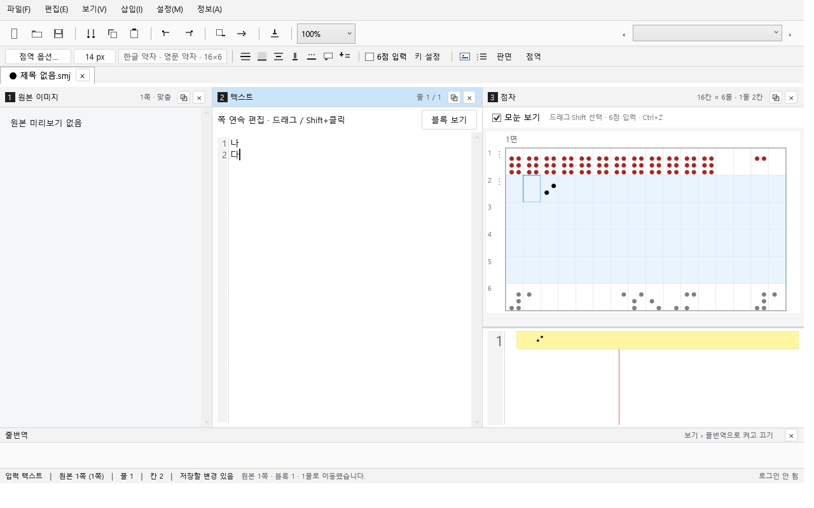

# Windows 검증 기록

2026-10-20. 아래는 실제 실행 결과이며 운영 서버 E2E나 점역 규정 전체의 정확도 인증과 구분한다.

## 2026-10-20 C-01~C-04 변경 후 macOS 실행

환경: macOS arm64, 프로젝트 내 `.build/dotnet` 10.0.401, `tmp/run-checks.command`(`dotnet build Semojum.sln -c Release` → `dotnet run --project tests/Semojum.Core.Tests -c Release --no-build`). 엔진 환경 변수 없이 실행해 실제 엔진 검사는 SKIP이며 통과로 세지 않는다. Windows 실행·WPF smoke는 아직 재실행하지 않았다.

- 1차 실행 10:49 KST: 핵심 검사 59/60 — 새 `SyncChecks` 5건 전부 통과, 실패 1건은 `.smj` 버전 상수(2→3)만 확인하던 기존 검사라 `SmjFile.Version` 기준으로 고쳤다. Desktop 교차 빌드는 WPF smoke fixture의 `ConversionProgress` 생성자 인수 누락 1건으로 실패해 수정했다.
- 2차 실행 11:31 KST: `dotnet build Semojum.sln -c Release` 경고 0·오류 0(Core·Desktop·Tests 교차 빌드), 핵심 검사 **60/60** 통과(기존 55 + `SyncChecks` 5). 실제 Python·패키징 엔진 검사는 환경 변수 미설정으로 SKIP. Windows 실행·WPF smoke·캡처는 저장소 push 후 기존 워크플로 결과로 갱신해야 하며, 이 수치를 Windows 통과로 인용하지 않는다.

## 통과한 실행

- 구현 커밋 `114860bd35c1668b02115898d133e126a44be00c`: [Windows editor 39274987611](https://github.com/Semojum/Semojum/actions/runs/39274987611), 전체 성공.
- macOS Windows 교차 빌드: 경고 0, 오류 0. 실제 Python v3.4.24 포함 핵심 검사 56/56.
- Windows 핵심 검사 55/55, 실제 Python·패키징 엔진을 포함한 통합 검사 57/57.
- Python 조판 검사 5개, 그 안의 160개 난수 BRF 일치·원문 셀 좌표 사례 통과.
- WPF 72개 검사와 정상 종료 코드 0. Windows Server 2025, .NET 10 환경.

이번 UI 검사는 실제 패키징 엔진을 사용한 BRF 기반 모눈, 보호된 생성 행, 여러 블록에 걸친 점자 교체와 한 번의 Undo, 12칸 연속 입력, 분리 창 조판 일치, 쪽바꿈 표식 보존·클립보드 제외, 원문 패널 연속 편집, Ctrl+A 블록/쪽 선택, Undo·읽기 전용을 포함한다. 화면 재그리기 전의 구간 선택 상태와 원문 연속 편집에서 블록별 메모 명령으로 이어지는 커서도 검사했다. 기존 PDF 내용·비율·잘못된 PDF 복구 검사도 유지한다.

이전 머리말 검사는 현재 면 적용·이전 면 보존·같은 면의 해제·블록 내부 위치·매칭 불가능한 수동 점자 보호를 포함한다. 핵심 검사에 `.smj` v1→v2 복원·저장 호환성을 추가했다. 이 실행 이후에는 연속 쪽바꿈으로 만든 빈 면에 입력할 때 앞뒤 면이 유지되는 실제 엔진 검사를 추가했으며 macOS의 56/56 검사와 Python 5개 검사를 다시 통과했다. 해당 최종 커밋의 Windows 결과는 PR에 연결된 Windows editor 실행을 따른다.

## 합성 원고 조판 측정

macOS 26.5.2 ARM64, Python 3.14.7, 실제 엔진 v3.4.24에서 원본 200쪽 × 24줄 × 32칸(점자 153,600칸)을 조판했다. 기본 홀수 페이지행과 원본 쪽 변경선으로 출력 197면을 생성했다. 동일 프로세스에서 3회 측정한 조판 시간은 38.6 / 54.9 / 56.9ms다.

이는 Python 조판 함수만의 실측값이다. 점역·JSON 전송·WPF 그리기·실제 원고와 이미지 로딩 시간은 포함하지 않는다. Windows 대용량 실원고의 체감 입력 지연을 검증한 수치로 사용하지 않는다.

## 종료 오류 재현과 수정

[이전 실행 e9edb73](https://github.com/Semojum/Semojum/actions/runs/39259153846)은 UI 검사 뒤 종료 코드 `0xC000000D`로 실패했다. CI 전용 네이티브 진단으로 `Windows.Data.Pdf.dll → d3d11.dll → d3d10warp.dll → ntdll.dll` 호출을 수집했다. 프로세스 종료 시 Windows PDF 구성 요소가 그래픽 자원을 해제하는 경로에서 발생했다.

PDF 미리보기를 PDFtoImage 5.4.0 / PDFium의 CPU 렌더링으로 교체했다. 렌더링을 직렬화하고 네이티브 비트맵·PNG 스트림은 작업 안에서 해제하며, WPF에는 독립된 동결 비트맵만 전달한다. PDF 검사를 제거하거나 비정상 종료를 성공으로 처리하지 않았다. 위 통과 실행에서 같은 PDF 내용 검사와 정상 종료를 함께 확인했다. 임시 네이티브 진단 코드는 검증 후 제거했다.

PDFium 152.0.7961의 배포 라이선스는 공식 `chromium/7961` 릴리스에서 가져왔고, 해당 DLL의 SHA-256과 NuGet의 win-x64 DLL이 일치함을 확인했다. 라이선스와 서드파티 고지는 `licenses/`에 보존한다.

## 실제 화면

아래는 Windows WPF 실행 캡처다. 전체 화면과 `checks.txt`는 위 실행의 `wpf-smoke`, 실행 가능한 포터블 ZIP은 `Semojum-win-x64` 아티팩트에 있다.

## 남은 환경 검증

Windows 10/11 사용자 PC의 한국어 IME·물리 키보드 동시 입력·보조기기·다중 DPI·프린터 검증은 별도다. 운영 로그인·유료 변환·서버 저장 성공·실제 배포 업데이트·물리 인쇄는 실행하지 않았다. 신규 점자 저장 ID 결함은 [BE 수정 제안](backend-save-review.md), 후속 엔진 확장은 [엔진 계약](engine-contract.md), 범위는 [구현 상태](implementation-status.md)를 따른다.
